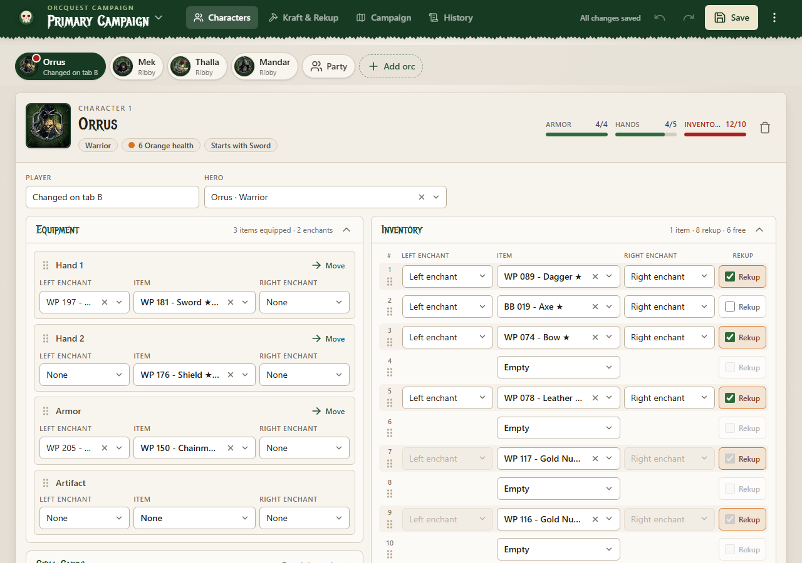
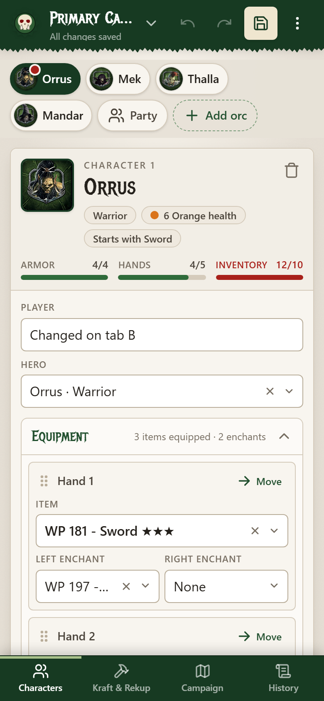
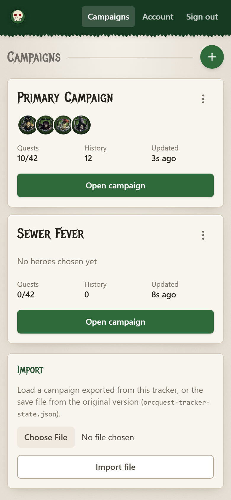
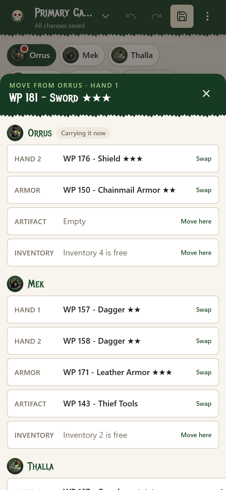
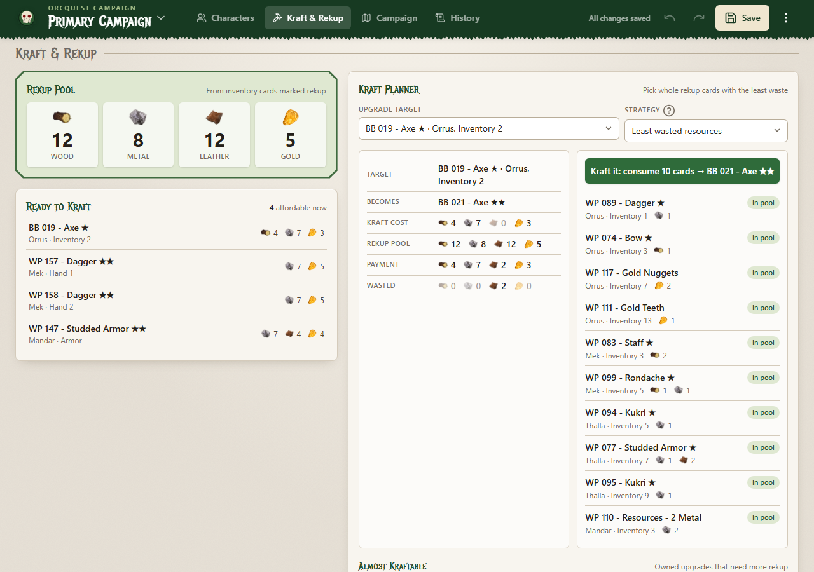
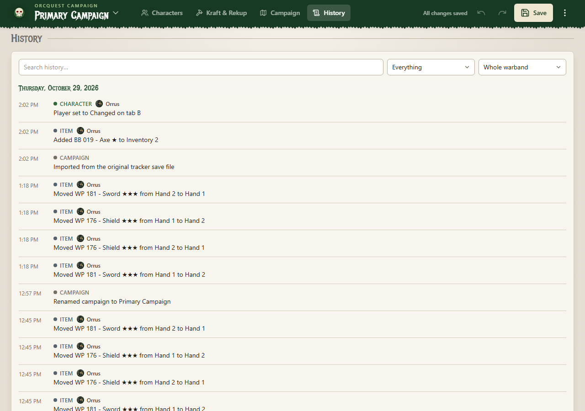

# OrcQuest Upgrade Tracker

A campaign companion for **OrcQuest WarPath**: track your warband's heroes, skills, equipment, inventory and enchants, see what the rekup pool can pay for, plan krafts with the fewest wasted resources, tick off quests, and keep a full history of everything that happened. It works on desktop, tablet and phone.

> **Unofficial fan-made tool.** This is a free fan project. It is not affiliated with, endorsed by, or connected to Monolith. OrcQuest WarPath, its names, artwork and game content belong to Monolith.

<p align="center">
  
  
</p>

## Contents

- [Features](#features)
- [Quick start (run it on your computer)](#quick-start-run-it-on-your-computer)
- [Using the tracker](#using-the-tracker)
- [Hosting it on the internet](#hosting-it-on-the-internet)
- [Configuration](#configuration)
- [Development](#development)

## Features

- **Accounts and campaigns**: sign in, keep any number of campaigns, switch between them from the header, duplicate, export and import them.
- **Character sheets** for up to six orcs: hero, player, skill cards, two hands, armor and artifact (each with left/right enchants), and 15 inventory slots.
- **Rules built in**: each card, hero and enchant can only be in one place; two-handed weapons fill both hands; cards marked for rekup stay out of equipment; resources, gold and potions are always rekup; carrying limits turn red when exceeded.
- **Item levels** shown as stars (`Axe ★★`), worked out from the kraft chains in the card list.
- **Kraft planner** that picks the exact rekup cards to pay for an upgrade, with five strategies (least waste, or keep the most wood / metal / leather / gold), then performs the kraft in one tap.
- **History** of every change (items moved or traded, rekup, enchants, upgrades, skills, quests, characters joining or leaving), searchable and filterable.
- **Phone friendly**: bottom tab bar, compact slots, and a tap-to-move sheet instead of long drags.
- **Safe saving**: changes save automatically; Undo/Redo; a save from an out-of-date tab is refused instead of overwriting newer changes.

## Quick start (run it on your computer)

### Requirements

| Tool | Version | Notes |
|---|---|---|
| PHP | 8.3 or newer | With the `pdo_sqlite`, `sqlite3`, `mbstring`, `openssl`, `fileinfo` and `xml` extensions (on by default in most installs). On Windows, [Laravel Herd](https://herd.laravel.com) is the easiest way to get PHP. |
| Composer | 2.x | [getcomposer.org](https://getcomposer.org) |
| Node.js | 20 or newer | Only needed to build the styles and scripts. |

No database server is needed: the tracker uses a single SQLite file by default.

### Install

```bash
git clone https://github.com/lotius/OrcQuestTracker.git
cd OrcQuestTracker
composer run setup
```

`composer run setup` installs the PHP and JavaScript packages, creates `.env`, generates the app key, creates the SQLite database (`database/database.sqlite`), runs the migrations and builds the front end.

### Run

```bash
composer run dev
```

Open <http://127.0.0.1:8000>. The first visit asks you to **claim the tracker** by creating the first account.

> **Coming from the original (pre-login) version?** If `storage/app/private/orcquest-tracker-state.json` exists, the first account you create inherits all of its campaigns and history automatically. The old file is kept, renamed with an `.imported-<date>` suffix.

### Run the tests

```bash
php artisan test   # accounts, campaigns, saving, history (PHP)
npm test           # the kraft planner, checked against an exhaustive search over thousands of random hands
```

## Using the tracker

### Accounts

- The **first account** created on a fresh install owns the tracker. Anyone can create further accounts until you set `ALLOW_REGISTRATION=false` (see [Configuration](#configuration)).
- Campaigns are private: each account only ever sees its own.
- Change your name, email or password under **Account**. Sign out from the header (or the `⋮` menu on a campaign).

### Campaigns



- **Campaigns** lists every campaign with its heroes, quest progress and last change.
- Press the round **+** button to start a new campaign. Give it a name and, optionally, start from a copy of an existing one. **Create & open** takes you straight into it; **Cancel** clears the form and closes it.
- Each card's `⋮` menu can **rename**, **duplicate**, **export to file** or **delete** the campaign. Deleting asks first and cannot be undone, so export first if you might want it back.
- **Import** loads a campaign file exported from the tracker, or the save file from the original version.
- Inside a campaign, click its **name in the header** to switch to another campaign or create a new one. Signing in reopens the campaign you used last.

<br clear="right">

### Characters

- New campaigns start with four orcs. **Add orc** brings in a fifth and sixth; the trash icon removes one (after confirming), clearing their sheet so their cards are free again. **Undo** brings them back.
- Switch orcs with the **portrait chips** at the top. **Party** shows every orc at once, which is handy for dragging cards between them on a big screen.
- Pick the **Hero** and type the **Player**. The hero sets the class, health, starting stuff and carrying limits; the **Armor / Hands / Inventory** meters turn red when a limit is exceeded, and the hero's chip gets a red dot.
- **Skill cards**: each tier (10 / 20 / 30 Badass Points) shows the cards learned plus one empty slot for the next. Only the chosen hero's skills are offered.

### Equipment and inventory

- Every equipment slot (**Hand 1, Hand 2, Armor, Artifact**) and inventory slot holds one card plus a **left** and **right enchant**. Enchants travel with their card when it moves.
- **Stars** after an item name show its kraft level: ★ can be upgraded, ★★ was upgraded and can be again, ★★★ is fully upgraded. Potions, resources, gold and relics have no level.
- Hover an item or enchant (desktop) to see its weight, hands, rekup value, kraft cost and effects.
- **Two-handed weapons** (bows, crossbows, ...) automatically fill both hands; anything that was in the other hand moves to the first free inventory slot.
- **Rekup** (inventory only) marks a card as broken down into resources. It then counts as weight 1, adds its resources to the rekup pool, and **cannot be equipped**: untick Rekup first. Resources, gold and potion cards are always rekup.

### Moving cards

- **Drag** a card by its item field (mouse) or by the grip/number beside the slot (mouse, touch or pen) onto another slot. Dropping onto a filled slot swaps the two cards. A slot that can't take the card outlines red and a message explains why.
- **Tap to move** (best on phones): tap the slot number or grip, or **Move** on an equipment slot. A sheet lists every orc's hands, armor, artifact and first free inventory slot, showing what each holds (**Swap**) or why it is unavailable.

<p align="center"></p>

### Kraft & Rekup

<p align="center"></p>

- **Rekup pool**: total wood, metal, leather and gold from every inventory card marked rekup, across the whole warband.
- **Ready to kraft**: owned upgrades the pool can pay for right now. Click one to load it into the planner.
- **Kraft planner**: the **Upgrade target** list only offers upgrades the pool can afford. The planner shows the kraft cost, the payment it suggests, any resources that would be wasted, and the exact cards to consume.
- **Strategy** decides which cards to spend:
  - *Least wasted resources*: the payment closest to the cost; ties go to fewer cards.
  - *Keep the most wood / metal / leather / gold*: spends as little of that resource as possible, then minimises waste.
- **Kraft it** consumes the payment cards and swaps the item for a free card of the next level, keeping its enchants. Remaining inventory moves up to fill the gaps.
- **Almost kraftable** lists owned upgrades that still need more rekup, and exactly what is missing.

### Campaign tab

Name the campaign, tick off completed quests for each quest book (with per-book progress), and keep free-form notes.

### History

<p align="center"></p>

Every save is compared with the previous one and the differences are logged as plain sentences: characters joining or leaving, hero and player changes, skills learned, cards added, removed, moved or traded between orcs, rekup, enchants, upgrades, kraft payments, quests and notes. Changes made with Undo/Redo are labelled, and fast typing in a text field is folded into one entry. Entries are grouped by day and can be searched or filtered by type and by orc. History travels with duplicated, exported and imported campaigns.

### Saving

- Changes **save automatically** a moment after you make them; the header shows *Saving…* / *Saved*. **Save** forces it immediately.
- **Undo / Redo** cover the last 25 changes in this browser tab.
- If the same campaign was changed in another tab or on another device after you opened it, your save is **refused** (nothing is overwritten) and a banner asks you to reload. If your session has expired, a banner asks you to sign in again.

## Hosting it on the internet

The tracker runs on any host with **PHP 8.3+**: cheap cPanel shared hosting (like SparkedHost's web hosting plans), a VPS, or a managed Laravel host. It needs no database server and very little bandwidth (about 5 MB for a long game night).

**[Read the deployment guide →](docs/DEPLOYMENT.md)** It walks through shared cPanel hosting step by step, plus a VPS setup, updating, backups and troubleshooting.

## Configuration

Settings live in `.env` (copied from `.env.example` during setup).

| Key | Default | Meaning |
|---|---|---|
| `APP_NAME` | `OrcQuest Tracker` | Name used in page titles and emails. |
| `APP_ENV` | `local` | Use `production` on a live server. |
| `APP_DEBUG` | `true` | **Must be `false` on a live server.** |
| `APP_URL` | `http://localhost` | The address the tracker is served from, e.g. `https://tracker.example.com`. |
| `APP_KEY` | *(generated)* | Encryption key. Generate once with `php artisan key:generate`; never share it. |
| `ALLOW_REGISTRATION` | `true` | Set to `false` once your account exists so strangers cannot sign up. The first account can always be created. |
| `DB_CONNECTION` | `sqlite` | `sqlite` (a file at `database/database.sqlite`) or `mysql`/`mariadb` with the usual `DB_HOST`, `DB_DATABASE`, `DB_USERNAME`, `DB_PASSWORD`. |
| `SESSION_LIFETIME` | `120` | Minutes before an idle session expires (*Keep me signed in* lasts much longer). |

## Development

| Path | What it holds |
|---|---|
| `resources/data/orcquest.json` | The catalog: heroes, items, enchants and campaign quests. |
| `app/Services/OrcQuestCatalog.php` | Loads the catalog and derives item levels. |
| `app/Services/CampaignState.php` | The shape of a campaign's state, upgrading old saves, and cleaning incoming saves against the catalog. |
| `app/Services/Campaigns.php` | Every write to a campaign: versioned saves, history, duplicate, import/export. |
| `app/Services/TrackerHistory.php` | Turns the difference between two saves into history entries. |
| `resources/views/tracker.blade.php` | The campaign page. |
| `resources/js/app.js` | Front-end behaviour (rules, drag and drop, move sheet, auto-save). |
| `resources/js/kraft.js` | The kraft payment planner (pure functions, unit tested). |
| `resources/css/app.css` | Theme and component styles (Tailwind CSS 4). |
| `scripts/package-release.ps1` | Builds an upload-ready zip for shared hosting (see the deployment guide). |

Built with Laravel 13, Blade, Tailwind CSS 4, Vite and vanilla JavaScript.

Useful commands:

```bash
composer run dev        # app server + Vite with hot reload
npm run build           # production build of styles and scripts
php artisan test        # PHP tests
npm test                # kraft planner tests
```
